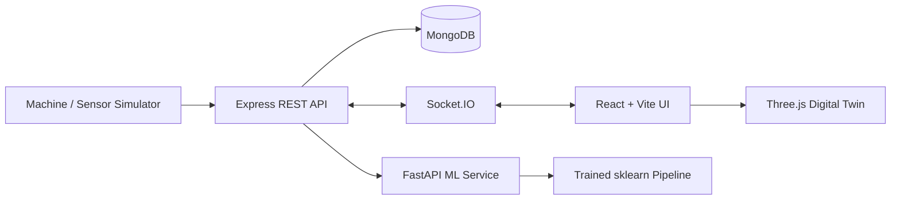

# Preventix — Understand. Predict. Prevent.

Preventix is a phased industrial monitoring and predictive-maintenance platform. This repository includes **Phases 1–5**: the React/Vite interface, Express/Mongoose API foundation, and API-connected dashboard, machine registry, alerts, and maintenance workflows. The dashboard clearly labels its illustrative fallback if the API is unavailable. Phase 5 adds a reproducible offline model-training and evaluation pipeline using the public UCI AI4I benchmark dataset. It is not yet wired into live API inference, and there is no physical sensor connection.

**Primary tagline:** Understand. Predict. Prevent.

## Implemented in this repository

### Frontend
- Light/dark industrial operations design system with a persistent theme toggle and responsive sidebar/header.
- Dashboard metric cards, fleet-health visualization, selectable sensor-trend chart, machine status table, alerts, and maintenance preview.
- Routed workspace pages for machines, digital twin, predictive maintenance, analytics, alerts, maintenance, and settings. The machine registry, alerts, and maintenance pages now use the Express API.
- Honest demo-mode labels, accessible labels, keyboard focus styles, reduced-motion support, and responsive layouts.
- Dashboard summary, machine list, alerts, and maintenance preview load from the Express API when it is reachable; the dashboard visibly falls back to demo records if the API is unavailable.
- Machine registry supports API-backed search/filtering and machine creation. Alerts support acknowledge/resolve actions. Maintenance supports task creation and status changes. These pages include loading, error/retry, and empty states.
- Vite `/api` proxy to the Express server on port 4000.

### Backend foundation
- Express API with liveness/readiness endpoints, CORS allowlist, bounded JSON body size, not-found handling, and centralized error responses.
- Mongoose schemas and indexes for machines, sensor readings, alerts, maintenance tasks, and prediction records.
- Zod request validation, pagination limits, duplicate-resource responses, and consistent API envelopes.
- Machine list/detail/create/update endpoints and machine-specific sensor-reading endpoints.
- Alert listing/creation/status updates; maintenance task listing/creation/status updates; prediction-record listing/creation.
- Database-backed dashboard summary endpoint.
- Idempotent-by-machine-key demo seeding for machines, with generated simulated readings, alerts, and maintenance tasks.
- Automated API tests for liveness, 404 handling, and validation that do not require MongoDB.

## Architecture roadmap



The current backend can persist machine and workflow records when MongoDB is available. Sensor readings inserted through the API are recorded as submitted; the automatic simulator, Socket.IO updates, FastAPI inference, and 3D digital twin are planned follow-on phases. The prediction endpoint records outputs from a prediction workflow; it **does not itself run a trained model**.

## Prerequisites

- Node.js 20 or newer
- npm 10 or newer
- MongoDB local instance or MongoDB Atlas URI

## Install and run

1. Install workspace dependencies from the repository root:

   ```bash
   npm install
   ```

2. Create `server/.env` (inside the `server` folder, alongside its `package.json`) and set `MONGODB_URI` to your MongoDB connection string. For Atlas, use your cluster URI and include `/preventix` as the database name. For local MongoDB, use `mongodb://127.0.0.1:27017/preventix` if MongoDB Community Server is running on the default port. Keep credentials out of Git.

3. Seed the database with clearly labeled sample records:

   ```bash
   npm run seed
   ```

4. Start both API and frontend:

   ```bash
   npm run dev
   ```

Vite normally serves the UI at `http://localhost:5173`; the API listens at `http://localhost:4000`. Use `Ctrl+C` to stop both. The backend requires a reachable MongoDB instance to start; the liveness endpoint itself does not require a database connection after the app is imported.

Run the frontend alone with `npm run dev:client`, or the API alone with `npm run dev:server` (the API requires MongoDB). Build the frontend with `npm run build`, and run API tests with `npm test`.

## API overview

All endpoints are prefixed with `/api`.

| Method | Endpoint | Purpose |
|---|---|---|
| GET | `/health` | API liveness and database connection state |
| GET | `/health/ready` | Readiness; returns 503 while MongoDB is disconnected |
| GET | `/dashboard/summary` | Counts and availability calculated from database records |
| GET, POST | `/machines` | List/filter/paginate machines; register a machine |
| GET, PATCH | `/machines/:id` | Get a machine and its latest reading; update machine fields |
| GET, POST | `/machines/:id/readings` | Read sensor history; store a validated reading |
| GET, POST | `/alerts` | List and create alerts |
| PATCH | `/alerts/:id/status` | Acknowledge or resolve an alert |
| GET, POST | `/maintenance` | List and create maintenance tasks |
| PATCH | `/maintenance/:id/status` | Update maintenance task status |
| GET, POST | `/predictions` | List and persist prediction records from a workflow |
| GET | `/simulator/status` | Read bounded sensor simulator state |
| POST | `/simulator/start` | Start synthetic sensor readings at a configured interval |
| POST | `/simulator/stop` | Stop synthetic sensor readings |

Machine IDs such as `CNC-001` and MongoDB document IDs are accepted for machine detail/readings routes. List responses include pagination metadata. Validation failures return HTTP 400 with `error.code = VALIDATION_ERROR`; duplicate unique fields return HTTP 409.

Example liveness check:

```bash
curl http://localhost:4000/api/health
```

Example machine list:

```bash
curl "http://localhost:4000/api/machines?page=1&limit=20"
```

## Routes

- `/dashboard`
- `/machines`
- `/machines/:id` (detail scaffold; detailed persisted machine view is a later phase)
- `/digital-twin`
- `/predictions`
- `/analytics`
- `/alerts`
- `/maintenance`
- `/settings`

## Data and safety notes

- The seed script creates records marked `simulated` or `demo`; these are not live factory readings.
- The machine registry, alerts, and maintenance pages use the API directly and show request errors instead of silently substituting demo records. The dashboard uses labeled sample fallback data when API calls fail.
- The dashboard consumes persisted API data for machine counts, machine status, alerts, and maintenance previews when the API is reachable. The sensor trend chart remains illustrative until the next readings-visualization integration, and the dedicated machine/alert/maintenance pages still need their full CRUD workflows wired to the API.
- Phase 5 adds an offline Python/scikit-learn training workflow under `ml/`; its model artifact is not yet consumed by the API. The current API does not implement authentication or role-based authorization. Do not expose it publicly or use it as a production control plane until authentication, authorization, rate limiting, audit logging, and deployment hardening are implemented.
- The prediction API stores supplied model/rule/demo results; it does not make an inference call. Do not use illustrative values for operational maintenance decisions.
- Physical sensor ingestion, model training/evaluation, SHAP-compatible explanations, and the interactive 3D twin remain planned work. Phase 4 adds synthetic sensor simulation and Socket.IO only.

## Phase 4: Live sensor simulation and Socket.IO

Open **Live Sensor Monitor** in the left navigation. The simulator is manual-start only and produces synthetic readings for active machines in the database.

- Start/stop through the UI; select a 2–60 second interval (default 5 seconds).
- Readings are persisted in `SensorReadings` with `source: "simulated"` and streamed to connected browsers over Socket.IO.
- The simulator is bounded to 50 active machines per tick, 1,000 readings per session, and 30 minutes per session. It automatically stops at a session limit.
- Use `GET /api/simulator/status`, `POST /api/simulator/start` with `{"intervalMs":5000}`, and `POST /api/simulator/stop` to inspect/control it.
- The Vite development proxy forwards `/socket.io` to the API on port 4000.
- The monitor's values and event list are demo telemetry only. This phase does not create ML predictions or auto-trigger maintenance decisions.

### Phase roadmap

5. Reproducible AI4I dataset download, training, and evaluation are included under `ml/`.
6. Add FastAPI inference and explainability with explicit model metadata.
7. Add an interactive Three.js digital twin linked to machine state.
8. Add maintenance automation, alert deduplication for ML risk, workflow audit events, and database-backed analytics aggregation. Authentication and role-based authorization remain required before public deployment.
9. Add API security headers, a basic in-process rate limit, validation regression tests, frontend container build configuration, and release-readiness documentation. Production deployment still requires environment-specific security and end-to-end verification.


## Phase 5: ML training and evaluation

See [`ml/README.md`](ml/README.md) for Windows setup and commands. In brief, create a Python virtual environment, install `ml/requirements.txt`, then run `python ml/scripts/train_model.py`. The script downloads the UCI AI4I dataset if absent and writes a scikit-learn pipeline plus evaluation metrics under `ml/artifacts/`. Run `python ml/scripts/predict_sample.py --input ml/sample_input.json` for an offline smoke test after training.

The model is a benchmark only and is not called by the Express API. Phase 6 will add a separate FastAPI inference service. Do not use benchmark outputs as real-world maintenance or safety decisions without plant-specific validation and human review.


## Phase 6 — ML inference integration

See [`docs/PHASE6-INTEGRATION.md`](docs/PHASE6-INTEGRATION.md) for how to run the FastAPI ML service and use the prediction panel on the Live Sensor Monitor. Train the model first if `ml/artifacts/failure_model.joblib` is missing. The public benchmark model is for demonstration only.


## Phases 8–9

Phase 8 adds idempotent maintenance alert automation, audit events for alert/task status changes, automatic deduplicated alerts for high/critical ML inference, database-backed 30-day operational analytics, and CSV export of recent sensor readings. Phase 9 adds API hardening baseline, basic rate limiting, tests, Docker/Nginx frontend packaging, and a production-readiness checklist. See [`docs/PHASE8-9-DELIVERY.md`](docs/PHASE8-9-DELIVERY.md). Authentication and role-based access are not implemented and must be completed before public deployment.
